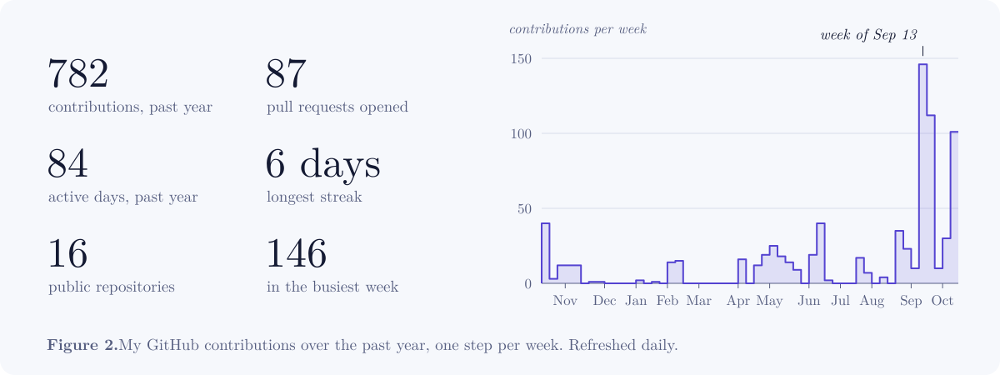
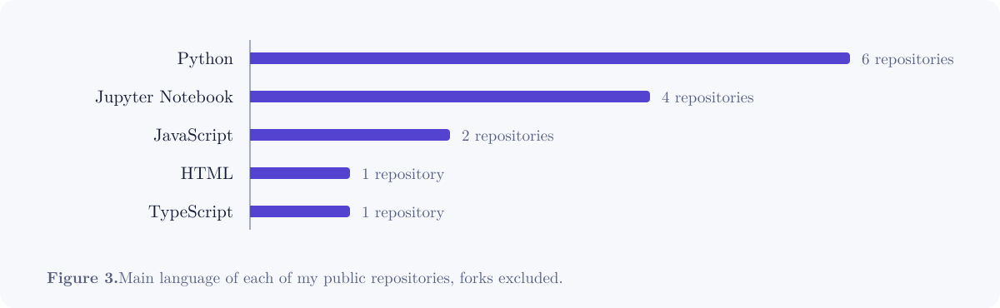
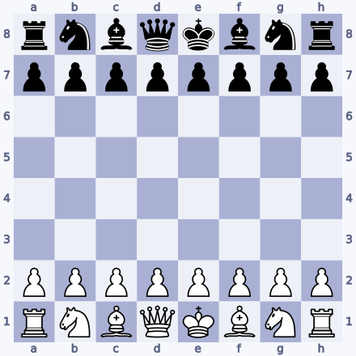
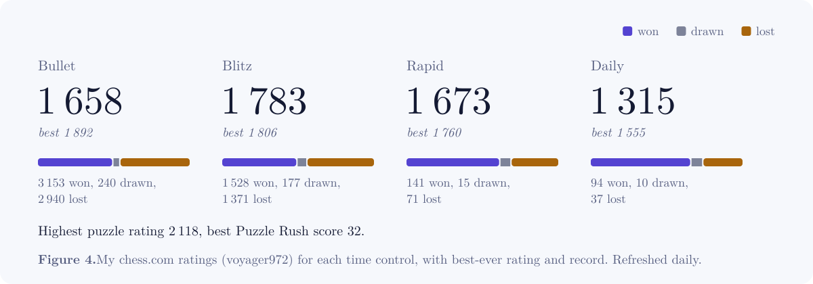

<!--
  This profile is laid out like a short paper. Blocks between START/END markers
  are rewritten by scripts/refresh.py and scripts/chess_game.py; edit anything else freely.
-->

<picture>
  <source media="(prefers-color-scheme: dark)" srcset="assets/hero-dark.svg">
  
</picture>

  <a href="https://tanmay-starslab.github.io/"><picture><source media="(prefers-color-scheme: dark)" srcset="assets/links/website-dark.svg"></picture></a>
  <a href="https://scholar.google.com/citations?user=Sfeb8fMAAAAJ&hl=en"><picture><source media="(prefers-color-scheme: dark)" srcset="assets/links/scholar-dark.svg"></picture></a>
  <a href="https://tanmay-starslab.github.io/files/cv.pdf"><picture><source media="(prefers-color-scheme: dark)" srcset="assets/links/cv-dark.svg"></picture></a>
  <a href="https://www.linkedin.com/in/tanmay-singh-21574a1aa/"><picture><source media="(prefers-color-scheme: dark)" srcset="assets/links/linkedin-dark.svg"></picture></a>
  <a href="mailto:tsingh65@asu.edu"><picture><source media="(prefers-color-scheme: dark)" srcset="assets/links/email-dark.svg"></picture></a>
  <a href="https://www.chess.com/member/voyager972"><picture><source media="(prefers-color-scheme: dark)" srcset="assets/links/chess-dark.svg"></picture></a>

> **Abstract.** I'm a fourth-year Ph.D. candidate at Arizona State University's School of Earth and Space Exploration, working with Prof. Sanchayeeta Borthakur. I study the circumgalactic and intragroup medium: the thin gas around galaxies and galaxy groups that records how they take in, recycle and lose matter. I read that gas in the light of background quasars, and I build synthetic absorption spectra from cosmological simulations (IllustrisTNG, TNG50 and SIMBA) to compare with what the Hubble Space Telescope sees. Before ASU I studied Engineering Physics at IIT Delhi.
>
> **Keywords:** circumgalactic medium, quasar absorption lines, galaxy groups, cosmological simulations, Bayesian inference

## 1&ensp;Research

**Where Mg II absorbers come from.** The cool clouds we see in quasar spectra could be gas blown out of galaxies, or gas spiralling in on rotating disks. I match mock Mg II absorbers in IllustrisTNG and SIMBA to the galaxies around them to tell the two apart.
Code: [syn-sightline-tng](https://github.com/tanmay-starslab/syn-sightline-tng), [trident_ls](https://github.com/tanmay-starslab/trident_ls)

**O VI in galaxy groups.** Synthetic O VI absorption in SIMBA and TNG50 galaxy groups, set against the COS-IGrM observations: column densities, kinematics, covering fractions, and which galaxy each absorber belongs to.
[Paper](https://arxiv.org/abs/2604.18808), [code](https://github.com/tanmay-starslab/OVI_IGrM)

**How the outer halo rotates.** Whether gas in the outer circumgalactic medium of Milky Way–mass galaxies co-rotates with the disk or runs against it, measured along synthetic sightlines through TNG50-1.
Code: [tng-mw-kinematics-spec](https://github.com/tanmay-starslab/tng-mw-kinematics-spec)

**Classifying supernovae and AGN.** Probabilistic spectral classification written in BLOG, a Bayesian logic language. Along the way I wrote [syntax highlighting for BLOG in VS Code](https://github.com/tanmay-starslab/blog-syntax).

<b>Side projects</b>

 

- [**cgm-absorption-movie**](https://github.com/tanmay-starslab/cgm-absorption-movie): a split-panel movie of quasar sightlines piercing a simulated galaxy's CGM, made with yt and Trident and parallelised on Slurm.
- [**jwst-velocity-resolution**](https://github.com/tanmay-starslab/jwst-velocity-resolution): a two-minute Manim explainer of how JWST's resolving power sets a velocity floor, &Delta;v = c/R.
- [**cgm-absorber-requirements**](https://github.com/tanmay-starslab/cgm-absorber-requirements): the S/N and resolving power you need to detect and resolve CGM absorption components.
- [**neetcode-gpt**](https://github.com/tanmay-starslab/neetcode-gpt): a GPT built from scratch, one NeetCode ML exercise at a time.
- [**remote-loopback-auth-relay**](https://github.com/tanmay-starslab/remote-loopback-auth-relay): a VS Code extension that relays localhost OAuth callbacks into remote workspaces.

<b>Before the Ph.D.</b>

 

- **Site testing for an Indian submillimetre telescope** at the Raman Research Institute: precipitable water vapour over candidate sites in Ladakh from NASA and ECMWF reanalysis data. [Paper](https://arxiv.org/abs/2604.13487).
- **Fano resonances in cold atomic collisions**: how the profile of H–Kr scattering resonances changes with scattering angle. Published in the Indian Journal of Physics. [Paper](https://arxiv.org/abs/2507.17674).
- **Magnetic topology of the solar corona** (senior thesis): coronal line images from the 2017 total solar eclipse, analysed with the rolling Hough transform and compared against MHD.
- **Post-processing for quantum key distribution** (SURA project): software for entanglement-based QKD.
- **Acoustic sources on the Sun**: azimuthally averaged MURaM simulations.

## 2&ensp;Papers

<!-- PAPERS:START -->
1. Roy, N., Borthakur, S., Heckman, T., **Singh, T.** (2026). <em>Lighting Up the CGM: Strong, Jet-Aligned Hα Emission around Radio Galaxies</em>. arXiv:2606.30088. [abstract](https://arxiv.org/abs/2606.30088), [PDF](https://arxiv.org/pdf/2606.30088)
1. Borthakur, S., **Singh, T.**, French, D., et al. (2026). <em>Revealing Cosmic Ecosystems with the Hubble Space Telescope in 2030s and Beyond</em>. arXiv:2606.11506. [abstract](https://arxiv.org/abs/2606.11506), [PDF](https://arxiv.org/pdf/2606.11506)
1. **Singh, T.**, Borthakur, S., Nelson, D., Davé, R., McCabe, T. (2026). <em>Analysis of synthetic OVI absorption associated with galaxy groups in SIMBA and TNG50 simulations</em>. arXiv:2604.18808. [abstract](https://arxiv.org/abs/2604.18808), [PDF](https://arxiv.org/pdf/2604.18808)
1. **Singh, T.**, Rao, M. S., Thakur, R. B. (2026). <em>Site Quality Analysis for an Indian Submillimeter Telescope: A Reanalysis-Based Approach</em>. arXiv:2604.13487. [abstract](https://arxiv.org/abs/2604.13487), [PDF](https://arxiv.org/pdf/2604.13487)
1. **Singh, T.**, Borthakur, S., Nelson, D., McCabe, T. (2026). <em>Analysis of synthetic O VI absorption in galaxy groups of SIMBA and IllustrisTNG simulations</em>. American Astronomical Society Meeting Abstracts 247, 174.05.
1. **Singh, T.**, Singh, R. A., Koike, F., Iizawa, M., Azuma, Y. (2025). <em>Scattering Angle Dependence of Fano Resonance Profiles in Cold Atomic Collisions Analyzed with the Complex Valued w Parameter</em>. Indian Journal of Physics. [abstract](https://arxiv.org/abs/2507.17674), [PDF](https://arxiv.org/pdf/2507.17674)
<!-- PAPERS:END -->

Refreshed from arXiv every morning; new papers with my advisor show up on their own. The full list is on [Google Scholar](https://scholar.google.com/citations?user=Sfeb8fMAAAAJ&hl=en).

## 3&ensp;Tools

<picture>
  <source media="(prefers-color-scheme: dark)" srcset="https://skillicons.dev/icons?i=py,js,ts,bash,latex,linux,git,githubactions,vscode,pytorch,sklearn,anaconda&theme=dark&perline=12">
  
</picture>

**Software.** Python, NumPy, SciPy, pandas, Matplotlib, yt, Trident, Manim, XGBoost, OpenCV, BLOG, QGIS, Slurm.
**Data.** IllustrisTNG and TNG50, SIMBA, HST/COS spectra (COS-IGrM, COS-GASS).

## 4&ensp;Activity

<picture>
  <source media="(prefers-color-scheme: dark)" srcset="assets/generated/stats-dark.svg">
  
</picture>

<picture>
  <source media="(prefers-color-scheme: dark)" srcset="assets/generated/languages-dark.svg">
  
</picture>

**Recently pushed**

<!-- RECENT:START -->
- [**cgm-absorber-requirements**](https://github.com/tanmay-starslab/cgm-absorber-requirements) Python: S/N and resolving-power requirements for detecting and resolving CGM absorption components. Last push Oct 14.
- [**tanmay-starslab.github.io**](https://github.com/tanmay-starslab/tanmay-starslab.github.io) JavaScript: My academic website. Last push Oct 14.
- [**jwst-velocity-resolution**](https://github.com/tanmay-starslab/jwst-velocity-resolution) Python: A 2-minute Manim explainer: how JWST's spectral resolving power R becomes a velocity floor, dv = c/R. Last push Aug 31.
- [**neetcode-gpt**](https://github.com/tanmay-starslab/neetcode-gpt) Python: GPT built from scratch — assembled from my NeetCode ML course submissions. Last push Aug 10.
- [**m61-tng**](https://github.com/tanmay-starslab/m61-tng) Jupyter Notebook: Analysis of Mock Absorption in M61. Last push Aug 9.
<!-- RECENT:END -->

<picture>
  <source media="(prefers-color-scheme: dark)" srcset="https://raw.githubusercontent.com/tanmay-starslab/tanmay-starslab/output/github-snake-dark.svg">
  
</picture>

## 5&ensp;Today's astronomy picture

<!-- APOD:START -->
<table><tr>
<td width="50%"></td>
<td width="50%"><b>Mars and the Beehive Under an Aurora</b> October 14, 2026  What a cosmic coincidence! In today’s image, Mars joins the Beehive cluster (M44 or Praesepe) below an auroral curtain and above a horizon of happy little trees near Lansjärv, Sweden. An eruption off the Sun reached Earth on October 10th, 2026 causing strong disturbances in Earth’s magnetic field. <a href="https://science.nasa.gov/apod/">Read more on APOD</a>. Image credit: Petr Horálek (Institute of Physics in Opava), Josef Kujal, Vojan Höfer</td>
</tr></table>
<!-- APOD:END -->

From NASA's Astronomy Picture of the Day, refreshed every morning.

## 6&ensp;Your move

A community chess game that anyone can play. Every legal move below is a link.

<!-- CHESS:START -->
<table><tr><td width="48%" valign="top">

<picture>
  <source media="(prefers-color-scheme: dark)" srcset="chess/board-dark.svg">
  
</picture>

</td><td valign="top">

**Game 1, move 1. White to play.**

Click a move, then press **Create** on the issue page that opens. A bot checks the move, plays it and redraws this board within a minute or two.

| Piece | Moves |
| :-- | :-- |
| Knight | [Na3](https://github.com/tanmay-starslab/tanmay-starslab/issues/new?title=chess%7Cmove%7Cb1a3&body=I%27m+playing+Na3.+Press+%2A%2ACreate%2A%2A+and+the+bot+will+make+the+move+for+you+within+a+minute+or+two.) [Nc3](https://github.com/tanmay-starslab/tanmay-starslab/issues/new?title=chess%7Cmove%7Cb1c3&body=I%27m+playing+Nc3.+Press+%2A%2ACreate%2A%2A+and+the+bot+will+make+the+move+for+you+within+a+minute+or+two.) [Nf3](https://github.com/tanmay-starslab/tanmay-starslab/issues/new?title=chess%7Cmove%7Cg1f3&body=I%27m+playing+Nf3.+Press+%2A%2ACreate%2A%2A+and+the+bot+will+make+the+move+for+you+within+a+minute+or+two.) [Nh3](https://github.com/tanmay-starslab/tanmay-starslab/issues/new?title=chess%7Cmove%7Cg1h3&body=I%27m+playing+Nh3.+Press+%2A%2ACreate%2A%2A+and+the+bot+will+make+the+move+for+you+within+a+minute+or+two.) |
| Pawn | [a3](https://github.com/tanmay-starslab/tanmay-starslab/issues/new?title=chess%7Cmove%7Ca2a3&body=I%27m+playing+a3.+Press+%2A%2ACreate%2A%2A+and+the+bot+will+make+the+move+for+you+within+a+minute+or+two.) [a4](https://github.com/tanmay-starslab/tanmay-starslab/issues/new?title=chess%7Cmove%7Ca2a4&body=I%27m+playing+a4.+Press+%2A%2ACreate%2A%2A+and+the+bot+will+make+the+move+for+you+within+a+minute+or+two.) [b3](https://github.com/tanmay-starslab/tanmay-starslab/issues/new?title=chess%7Cmove%7Cb2b3&body=I%27m+playing+b3.+Press+%2A%2ACreate%2A%2A+and+the+bot+will+make+the+move+for+you+within+a+minute+or+two.) [b4](https://github.com/tanmay-starslab/tanmay-starslab/issues/new?title=chess%7Cmove%7Cb2b4&body=I%27m+playing+b4.+Press+%2A%2ACreate%2A%2A+and+the+bot+will+make+the+move+for+you+within+a+minute+or+two.) [c3](https://github.com/tanmay-starslab/tanmay-starslab/issues/new?title=chess%7Cmove%7Cc2c3&body=I%27m+playing+c3.+Press+%2A%2ACreate%2A%2A+and+the+bot+will+make+the+move+for+you+within+a+minute+or+two.) [c4](https://github.com/tanmay-starslab/tanmay-starslab/issues/new?title=chess%7Cmove%7Cc2c4&body=I%27m+playing+c4.+Press+%2A%2ACreate%2A%2A+and+the+bot+will+make+the+move+for+you+within+a+minute+or+two.) [d3](https://github.com/tanmay-starslab/tanmay-starslab/issues/new?title=chess%7Cmove%7Cd2d3&body=I%27m+playing+d3.+Press+%2A%2ACreate%2A%2A+and+the+bot+will+make+the+move+for+you+within+a+minute+or+two.) [d4](https://github.com/tanmay-starslab/tanmay-starslab/issues/new?title=chess%7Cmove%7Cd2d4&body=I%27m+playing+d4.+Press+%2A%2ACreate%2A%2A+and+the+bot+will+make+the+move+for+you+within+a+minute+or+two.) [e3](https://github.com/tanmay-starslab/tanmay-starslab/issues/new?title=chess%7Cmove%7Ce2e3&body=I%27m+playing+e3.+Press+%2A%2ACreate%2A%2A+and+the+bot+will+make+the+move+for+you+within+a+minute+or+two.) [e4](https://github.com/tanmay-starslab/tanmay-starslab/issues/new?title=chess%7Cmove%7Ce2e4&body=I%27m+playing+e4.+Press+%2A%2ACreate%2A%2A+and+the+bot+will+make+the+move+for+you+within+a+minute+or+two.) [f3](https://github.com/tanmay-starslab/tanmay-starslab/issues/new?title=chess%7Cmove%7Cf2f3&body=I%27m+playing+f3.+Press+%2A%2ACreate%2A%2A+and+the+bot+will+make+the+move+for+you+within+a+minute+or+two.) [f4](https://github.com/tanmay-starslab/tanmay-starslab/issues/new?title=chess%7Cmove%7Cf2f4&body=I%27m+playing+f4.+Press+%2A%2ACreate%2A%2A+and+the+bot+will+make+the+move+for+you+within+a+minute+or+two.) [g3](https://github.com/tanmay-starslab/tanmay-starslab/issues/new?title=chess%7Cmove%7Cg2g3&body=I%27m+playing+g3.+Press+%2A%2ACreate%2A%2A+and+the+bot+will+make+the+move+for+you+within+a+minute+or+two.) [g4](https://github.com/tanmay-starslab/tanmay-starslab/issues/new?title=chess%7Cmove%7Cg2g4&body=I%27m+playing+g4.+Press+%2A%2ACreate%2A%2A+and+the+bot+will+make+the+move+for+you+within+a+minute+or+two.) [h3](https://github.com/tanmay-starslab/tanmay-starslab/issues/new?title=chess%7Cmove%7Ch2h3&body=I%27m+playing+h3.+Press+%2A%2ACreate%2A%2A+and+the+bot+will+make+the+move+for+you+within+a+minute+or+two.) [h4](https://github.com/tanmay-starslab/tanmay-starslab/issues/new?title=chess%7Cmove%7Ch2h4&body=I%27m+playing+h4.+Press+%2A%2ACreate%2A%2A+and+the+bot+will+make+the+move+for+you+within+a+minute+or+two.) |

</td></tr></table>
<!-- CHESS:END -->

<picture>
  <source media="(prefers-color-scheme: dark)" srcset="assets/generated/chess-ratings-dark.svg">
  
</picture>

Want a real game? [Challenge me on chess.com](https://www.chess.com/member/voyager972), I'm Voyager972.

## Acknowledgements

I grew up in Lucknow, India. Away from simulations I play a lot of chess, photograph the night sky, read pop-science and non-fiction, follow geopolitics with a map open, and listen to ghazals, Sufi music and old Hindi songs.

Typeset in Latin Modern, the typeface of LaTeX. The figures are drawn by the Python in [`scripts/`](scripts) and refreshed by GitHub Actions.

