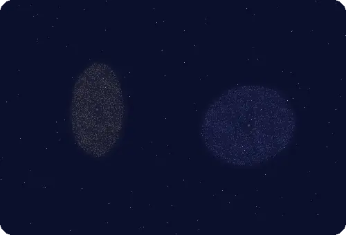
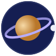

<!-- Blocks between START/END markers are rewritten by scripts/refresh.py. -->



<p align="center"></p>

<p align="center">
  <a href="https://tanmay-starslab.github.io/"></a>
  <a href="https://scholar.google.com/citations?user=Sfeb8fMAAAAJ&hl=en"></a>
  <a href="https://www.linkedin.com/in/tanmay-singh-21574a1aa/"></a>
  <a href="mailto:tsingh65@asu.edu"></a>
  <a href="https://tanmay-starslab.github.io/files/cv.pdf"></a>
</p>





###  whoami

```python
class Me(Astrophysicist):
    base     = "Tempe, AZ"
    hunting  = ["Mg II", "O VI", "C IV"]
    universe = ["TNG50", "SIMBA"]
    weapons  = ["python", "yt", "trident"]
    offline  = ["night sky", "ghazals"]
```

<br clear="right">


<h3 align="center"> toolbox</h3>


<h3 align="center"> activity</h3>


<picture>
  <source media="(prefers-color-scheme: dark)" srcset="https://raw.githubusercontent.com/tanmay-starslab/tanmay-starslab/output/github-snake-dark.svg">
  
</picture>


<h3 align="center"> tonight's sky</h3>

<!-- APOD:START -->
<p align="center">
  <a href="https://science.nasa.gov/apod/"></a>
  <br><sub><b>Mars and the Beehive Under an Aurora</b></sub>
</p>
<!-- APOD:END -->



<p align="right"></p>
