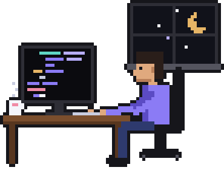
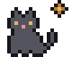
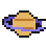
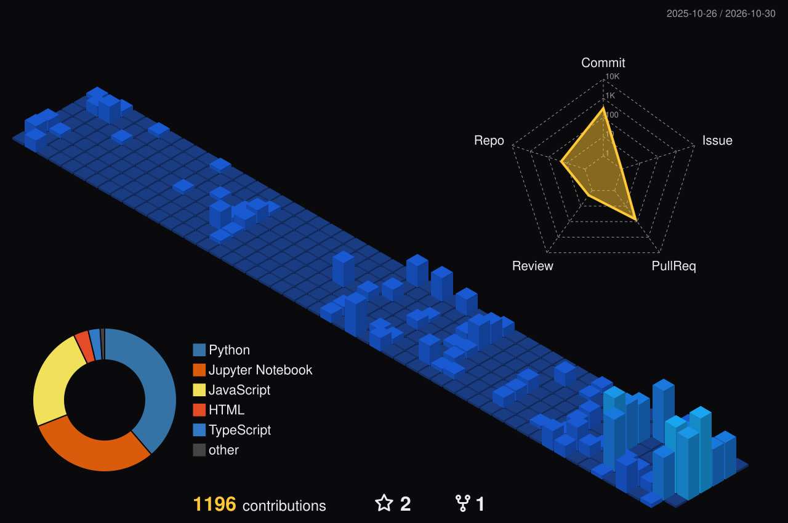
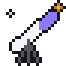
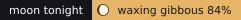
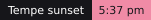

<!-- Blocks between START/END markers are rewritten by scripts/daily.py (the daily art and NASA's picture). -->

<!-- HERO:START -->

<!-- HERO:END -->

<p align="center"></p>

<p align="center">
  <a href="https://tanmay-starslab.github.io/"></a>
  <a href="https://scholar.google.com/citations?user=Sfeb8fMAAAAJ&hl=en"></a>
  <a href="https://www.linkedin.com/in/tanmay-singh-21574a1aa/"></a>
  <a href="mailto:tsingh65@asu.edu"></a>
</p>



### hey there 

```python
class Me(PhDStudent):
    field    = "astrophysics"
    at       = "Arizona State University"
    building = "simulated universes"
    code     = ["python", "javascript", "bash"]
    learning = ["machine learning", "manim"]
    offline  = ["stargazing", "music", "maps"]
```

 <em>always happy to talk galaxies and code, so say hi!</em>

<br clear="right">

<h3 align="center"> toolbox</h3>



<h3 align="center"> activity</h3>





<h3 align="center"> tonight's sky</h3>

<!-- APOD:START -->
<p align="center">
  <a href="https://science.nasa.gov/image-article/apod-2026-october-30-haunting-the-cepheus-flare/"></a>
  <a href="https://github.com/tanmay-starslab/tanmay-starslab/issues/new?title=reroll+the+universe&amp;body=Press+%2A%2ASubmit+new+issue%2A%2A+and+a+bot+draws+a+new+sky%2C+galaxy+and+merger+for+the+profile+%28it+closes+this+issue+for+you%2C+usually+within+two+minutes%29."></a>
  
</p>
<p align="center"><a href="https://github.com/tanmay-starslab/tanmay-starslab/issues/new?title=reroll+the+universe&amp;body=Press+%2A%2ASubmit+new+issue%2A%2A+and+a+bot+draws+a+new+sky%2C+galaxy+and+merger+for+the+profile+%28it+closes+this+issue+for+you%2C+usually+within+two+minutes%29."></a></p>
<!-- APOD:END -->

<!-- FOOTER:START -->

<!-- FOOTER:END -->

<p align="center">
  
  <a href="https://github.com/tanmay-starslab?tab=followers"></a>
  <a href="https://github.com/tanmay-starslab?tab=repositories"></a>
  
  
  
  <a href="https://github.com/tanmay-starslab/tanmay-starslab/actions/workflows/refresh.yml"></a>
</p>
